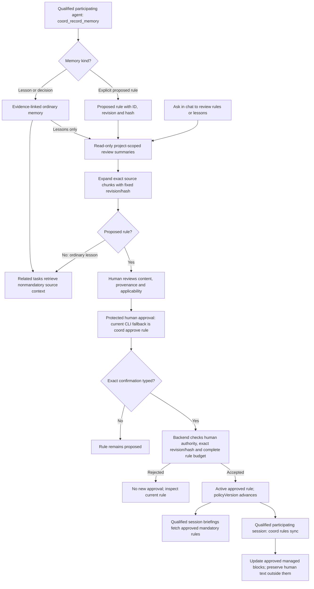

# Coord

Private implementation of Shared Agent Coordination v2.5: a TypeScript CLI, direct stdio MCP integrations for Codex and Antigravity, and a bring-your-own Convex backend.

**Not release-qualified.** Local tests do not establish live Convex concurrency, protected human approval, credential isolation, actual supervised harness behavior or two-machine continuation. The full scope includes autonomous dispatch and both directions of portable continuation; it has not been reduced to shared memory.

## Chat-first workflows

Coord is being built for conversation-first use: ask the agent to inspect work, review lessons, propose or approve a goal/rule, continue a task, manage membership or operate the backend. Plugins, skills and typed tools should carry every supported workflow; the CLI remains the supporting automation, diagnosis and terminal fallback interface.

Today the CLI and part of the MCP/plugin interface are implemented, including read-only conversational rule/lesson review. A qualified chat approval adapter is still missing. Protected actions always require authenticated human authority, whether presented in chat or a terminal. See [host support and remaining evidence](docs/hosts.md#conversational-workflows-and-human-confirmation) and the [workflow/CLI reference](docs/commands.md).

Ask “test confirmation” to exercise a synthetic no-effect host form through the Coord skill. The probe never grants approval authority or verifies a human, even when a client accepts. An isolated `coord mcp --confirmation-probe` mode supports temporary host diagnostics without project/backend credentials. See [the check and its evidence limits](docs/commands.md#no-effect-host-confirmation-check).

## Local development

Node 24 or newer is required. Dependencies are pinned in `package-lock.json`.

```sh
npm ci --ignore-scripts
npm run check
node dist/src/cli.js doctor --json
```

Doctor exits `2` when qualification gates are blocked and still emits valid redacted JSON. It does not install plugins, invoke a paid model, create a backend or publish code. Disposable primitive checks remain labelled `fixture`.

Implemented CLI entry points include `checkpoint`, `resume`, `review`, `daemon`, `run finalize`, `run reconcile`, `doctor`, `status`, `mcp`, `hook`, `rules sync`, project-scoped `export`, `setup inspect`, and protected `approve goal`, `approve policy` and `approve rule`. [Command workflows and supported modes](docs/commands.md) document exact usage and recovery. The protected `setup bootstrap` / `setup connect` commands are operator-only; follow the maintainer's protected onboarding procedure outside agent-controlled terminals. Backend-dependent commands require a trusted workspace association and the appropriate backend-bound agent/run credential. `COORD_SESSION_ID` identifies a participating host session; pending admission and its grant are persisted before the backend call. A persisted receipt never substitutes for current backend authority.

Do not manually synthesize human approval or qualification records to make admission pass. No `approved=true` switch, TTY check or ordinary file permission is treated as protected human participation.

## Learning and rule approval

Ask “show me rules to review,” “show lessons learned” or “show details/evidence for that item.” The Coord skill routes these requests to project-scoped `coord_review_memories` and `coord_review_memory`, available before joining a task. Summaries are paginated; exact detail chunks include full content, sources, applicability and confidence. Ordinary lessons stay nonmandatory, and review grants no approval. See [conversational review](docs/commands.md#conversational-review) for coverage and connection requirements.

Agents can record evidence-linked lessons and decisions for later retrieval, or explicitly propose a rule through `coord_record_memory`. A proposed rule becomes mandatory project guidance only when a human approves its exact revision and content/provenance hash with [`coord approve rule`](docs/commands.md#rule-approval). This keeps useful experience available without letting an agent turn its own suggestion into policy.



The diagram includes the implemented read-only review tools and existing approval primitive; real host discovery/delivery of the new tools remains unqualified. Its CLI fallback requires a separate operator terminal; the intended conversational adapter must preserve the same protected human decision without requiring manual command entry. Agents use the record, query and qualified synchronization surfaces. Approval does not synchronize files, update every checkout or automatically convert a lesson into a rule. `coord rules sync` is a separate operation for the current qualified participating session and preserves human-authored text outside its managed blocks.

## Implementation map

- `convex/`: exact approvals, scoped credentials/grants, transactional claims, scan coverage, messages/receipts, lessons/rules, checkpoint and publication acceptance, expiry, yield and bounded replanning.
- `src/checkpoint.ts`, `worktree.ts`, `environment.ts`, `review.ts`: audited portable snapshots, exact execution bases, fresh worktree allocation, effective environment checks and immutable PR publication/reconciliation.
- `src/launch.ts`, `supervisor.ts`, `launch-wrapper.ts`, `daemon.ts`, `convex/dispatch.ts`: durable lifecycle boundaries, independent watchdogs and deterministic dispatch. A model is not the scheduler. The parsed CLI and bound MCP workflows now compose these modules with durable recovery. Actual managed launch requires qualified Linux cgroup-v2 containment and protected runtime configuration; isolated verification uses an explicitly selected preinstalled Linux bubblewrap. Neither tool availability nor local fixtures qualify a host.
- `src/mcp.ts`, `hooks.ts`, `context.ts`, `rulesync.ts`, `plugins/`: direct backend coordination and bounded source-backed context. Native hooks are cooperative guardrails; actual coverage must be qualified.
- `tests/`: deterministic faults, exported backend-handler fixtures and disposable real Git/filesystem/process checks. Backend fixtures are not a Convex service.

## Continuing the release

Coord is bring-your-own-backend: provision your own Convex deployment, then run the protected operator bootstrap and connect steps in your own terminal. An agent must never perform bootstrap, hold the approver vault, or handle a passphrase.

Host qualification and an approved goal are required before any worker execution. Two worktrees on one machine are a rehearsal, not a two-machine result: each machine needs a distinct identity and an independently qualified execution environment.

Read [host integration](docs/hosts.md), [backend contracts](docs/backend.md), [checkpoint contracts](docs/checkpoints.md), [shared contracts](docs/contracts.md), [containment](docs/containment.md), [supervision](docs/supervision.md), [verification runtime](docs/verification-runtime.md), [host evidence](docs/doctor.md) and [setup and recovery](docs/operations.md). The specification, execution ledger and verification records are maintained by the maintainer and are not published here. A1–A7 remain mandatory. Package publication, license selection, production deployment, merge and protected approvals remain operator decisions.
